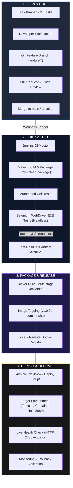

# 📋 Phase 2: Agile Planning & DevOps Workflow
## Mobile Recharge Portal (MRP)

---

### 1. User Stories & Acceptance Criteria

#### User Story 1 (US-01): Plan Discovery
> **As a** prepaid subscriber,  
> **I want to** select my telecom operator and browse plans categorized by validity, price, and benefits,  
> **So that** I can pick the most suitable recharge plan quickly.
- **Acceptance Criteria (Given-When-Then)**:
  - *Given* a user visits the portal,
  - *When* they select "Airtel" and "Unlimited",
  - *Then* only plans matching Airtel with unlimited calling and data allowances are displayed.

#### User Story 2 (US-02): Recharge Submission & Validation
> **As a** prepaid subscriber,  
> **I want to** enter my 10-digit mobile number and submit a recharge request,  
> **So that** my cellular balance is updated without entering incorrect digits.
- **Acceptance Criteria**:
  - *Given* an invalid mobile number (e.g. 9 digits or letters),
  - *When* the user attempts to submit the recharge,
  - *Then* the form prevents submission and alerts the user with "Please enter a valid 10-digit mobile number".
  - *Given* a valid 10-digit mobile number and selected plan,
  - *When* submitted,
  - *Then* a unique transaction ID (`TXN-XXXX`) is issued with initial status `SUCCESS` (or `PENDING`).

#### User Story 3 (US-03): Transaction Ledger & Search
> **As an** admin or customer support representative,  
> **I want to** search transactions by phone number, operator, or status,  
> **So that** I can quickly investigate customer complaints or verify transactions.
- **Acceptance Criteria**:
  - *Given* a ledger of 20 transactions,
  - *When* the user types "9876543210" in the live search bar,
  - *Then* only transactions corresponding to that mobile number remain visible.

#### User Story 4 (US-04): Status Workflow Management
> **As a** support administrator,  
> **I want to** change a transaction status from `PENDING` to `SUCCESS` or `FAILED`,  
> **So that** reconciled payment states are accurately reflected in real time.
- **Acceptance Criteria**:
  - *Given* a transaction in `PENDING` state,
  - *When* an admin clicks "Mark as Success",
  - *Then* the transaction status immediately changes to `SUCCESS`, and the dashboard counters update dynamically.

#### User Story 5 (US-05): Summary Analytics Dashboard
> **As an** operations manager,  
> **I want to** see summary metrics (total recharges, total revenue, success rate, operator breakdown),  
> **So that** I have instant visibility into portal performance.
- **Acceptance Criteria**:
  - *Given* multiple completed recharges,
  - *When* the dashboard loads,
  - *Then* it displays real-time calculated KPI cards and percentage health bars.

---

### 2. Product Backlog & 15-Task Sprint / Kanban Board

```
+---------------------------------------------------------------------------------------------------------+
|                                    15-TASK KANBAN WORKFLOW BOARD                                        |
+---------------------+-------------------------+-------------------------------+-------------------------+
|     TO DO (Backlog) |       IN PROGRESS       |         CODE REVIEW           |          DONE           |
+---------------------+-------------------------+-------------------------------+-------------------------+
| [TASK-11] Analytics | [TASK-06] Mock Payment  | [TASK-05] Recharge Form Valid | [TASK-01] Maven/Spring  |
| [TASK-13] Selenium  | [TASK-07] Receipt View  | [TASK-04] Plan Catalog View   | [TASK-02] Entities & DB |
| [TASK-14] Docker    | [TASK-08] Trans Ledger  |                               | [TASK-03] UI Layout     |
| [TASK-15] Ansible   | [TASK-09] Search Bar    |                               |                         |
|                     | [TASK-10] Status Engine |                               |                         |
|                     | [TASK-12] Git / CI Spec |                               |                         |
+---------------------+-------------------------+-------------------------------+-------------------------+
```

---

### 3. Definition of Done (DoD)
A task or user story is considered **Done** only when:
1. **Code Quality**: Clean code adhering to Java coding conventions, clean MVC separation, and zero compile errors.
2. **Version Control**: Committed to a dedicated feature branch with conventional commit messages (`feat:`, `fix:`, `ci:`) and merged via pull request.
3. **Automated Testing**: Unit tests pass and Selenium end-to-end regression tests succeed with 0 failures.
4. **CI/CD Build**: The Jenkins CI pipeline builds the artifact (`.jar`/`.war`) and completes all stages with a green checkmark.
5. **Containerization**: Passes Docker build verification without error and runs with healthy HTTP 200 response on mapped port 8080.
6. **Documentation**: Documented with configuration instructions and user guides.

---

### 4. DevOps Lifecycle Architecture Diagram


