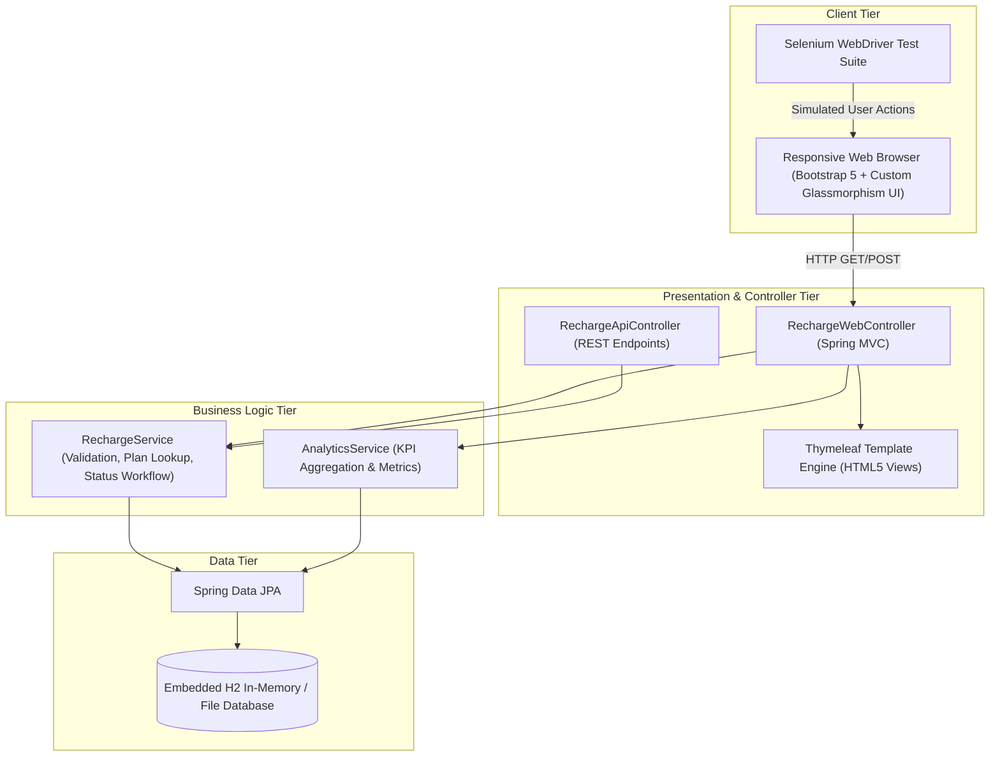

# 🏛️ Phase 3: Requirements, Architecture & Technology Setup
## Mobile Recharge Portal (MRP)

---

### 1. Software Requirements Specification (SRS) Summary
The Mobile Recharge Portal is an enterprise-grade web application designed for fast prepaid mobile top-ups, transaction logging, role-based status auditing, and operational business intelligence.

#### Functional Requirements
1. **Catalog Browsing**: System displays recharge plans filterable by operator (`Airtel`, `Jio`, `Vodafone Idea`, `BSNL`) and category (`Popular`, `Unlimited`, `Data`, `Talktime`).
2. **Recharge Initiation**: End-users can enter a 10-digit mobile number, choose an operator, select an amount, and submit a transaction.
3. **Transaction Record Creation**: Generates an immutable transaction record with timestamp, mobile number, operator, plan details, amount, reference code (`TXN-YYYYMMDD-XXXX`), and state (`SUCCESS`, `PENDING`, `FAILED`).
4. **Status Workflow Management**: Authorized operators/administrators can manually transition status of pending transactions to `SUCCESS` or `FAILED`.
5. **Real-time Search & Filter**: Real-time filtering across all recorded transactions without requiring full page reloads.
6. **Executive Dashboard**: KPI summary cards showing:
   - Total Recharges Count
   - Total Gross Revenue ($ / ₹)
   - Success Rate Percentage
   - Breakdown by Telecom Operator

#### Non-Functional Requirements
- **Performance**: Response time under 200ms for all web interactions.
- **Portability**: Packaged as a standalone runnable `.jar` (with embedded Tomcat) and containerized with Docker.
- **Maintainability**: Clear MVC architecture separating Controllers, Services, Repositories, and Views.
- **Testability**: Automated Selenium WebDriver tests running in headless Chrome or Edge.

---

### 2. Use-Case Diagram

```mermaid
usecaseDiagram
    actor "Customer / Subscriber" as Customer
    actor "Support Admin" as Admin
    actor "System / CI Engine" as System

    package "Mobile Recharge Portal" {
        usecase "Browse Recharge Plans" as UC1
        usecase "Validate Mobile Number" as UC2
        usecase "Initiate Recharge" as UC3
        usecase "View Digital Receipt" as UC4
        usecase "Search Transactions" as UC5
        usecase "Update Transaction Status" as UC6
        usecase "View Analytics Dashboard" as UC7
        usecase "Execute Health Check" as UC8
    }

    Customer --> UC1
    Customer --> UC2
    Customer --> UC3
    Customer --> UC4

    Admin --> UC5
    Admin --> UC6
    Admin --> UC7

    System --> UC8
```

---

### 3. Application System Architecture



---

### 4. Data Model Specifications

#### Table: `recharge_plans`
| Column Name | Type | Constraints | Description |
| :--- | :--- | :--- | :--- |
| `id` | `BIGINT` | PRIMARY KEY, AUTO_INCREMENT | Unique plan ID |
| `operator` | `VARCHAR(50)` | NOT NULL | Telecom operator (Airtel, Jio, Vi, BSNL) |
| `plan_name` | `VARCHAR(100)` | NOT NULL | Plan title (e.g. "True 5G Unlimited") |
| `category` | `VARCHAR(50)` | NOT NULL | Popular, Unlimited, Data, Talktime |
| `amount` | `DOUBLE` | NOT NULL | Cost in currency |
| `validity_days`| `INTEGER` | NOT NULL | Validity duration in days |
| `data_benefit` | `VARCHAR(100)`| NOT NULL | Data quota (e.g., "2.5 GB/day") |
| `description` | `VARCHAR(255)`| NOT NULL | Plan perks (e.g. Free OTT, Unlimited Calls) |

#### Table: `recharge_transactions`
| Column Name | Type | Constraints | Description |
| :--- | :--- | :--- | :--- |
| `id` | `BIGINT` | PRIMARY KEY, AUTO_INCREMENT | Unique primary key |
| `txn_reference`| `VARCHAR(64)` | NOT NULL, UNIQUE | Reference ID (e.g., `TXN-20261021-9382`) |
| `mobile_number`| `VARCHAR(15)` | NOT NULL | 10-digit subscriber number |
| `operator` | `VARCHAR(50)` | NOT NULL | Operator selected |
| `amount` | `DOUBLE` | NOT NULL | Recharge amount |
| `plan_name` | `VARCHAR(100)` | NOT NULL | Plan description summary |
| `status` | `VARCHAR(20)` | NOT NULL | `SUCCESS`, `PENDING`, `FAILED` |
| `created_at` | `TIMESTAMP` | NOT NULL | Transaction creation timestamp |
| `notes` | `VARCHAR(255)`| NULL | Internal admin notes or status remarks |

---

### 5. Core API Endpoints
| HTTP Method | Route | Description |
| :--- | :--- | :--- |
| `GET` | `/` | Home page & Plan Catalog |
| `GET` | `/plans?operator={op}` | Filtered plans for specific operator |
| `POST` | `/recharge` | Submit new recharge transaction |
| `GET` | `/receipt/{txnReference}` | Display transaction confirmation receipt |
| `GET` | `/admin/transactions` | Full ledger with search, filtering, and status action buttons |
| `POST` | `/admin/transactions/{id}/status` | Update transaction status (`SUCCESS` / `FAILED`) |
| `GET` | `/admin/dashboard` | Visual metrics and KPI analytics summary |
| `GET` | `/api/health` | Health check endpoint returning HTTP 200 `{ "status": "UP" }` |
| `GET` | `/api/transactions` | JSON REST representation of all transactions |
